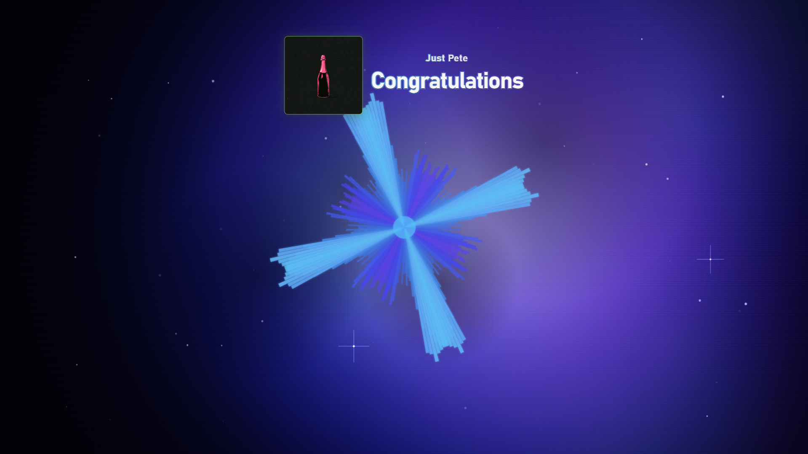
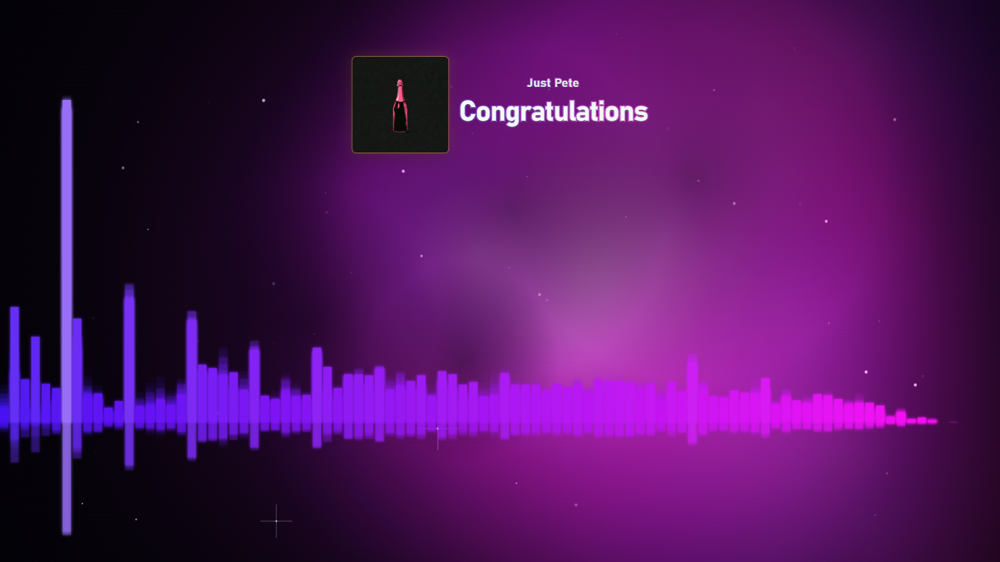
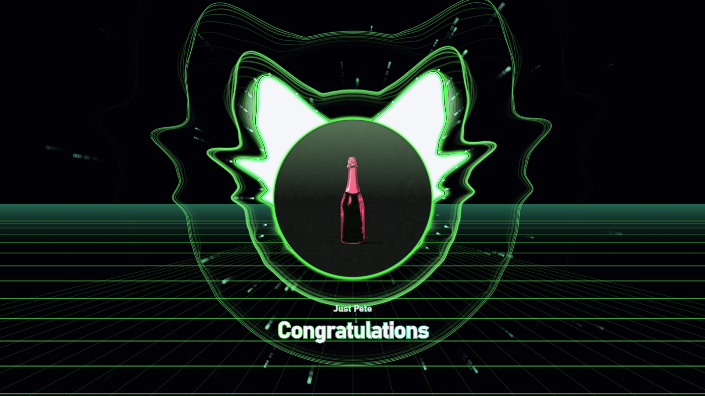

# Audio Visualizer

A standalone Windows app that turns whatever audio is currently playing on
your PC — Spotify, a game, a browser tab, anything — into a real-time music
visualizer, NCS-video style.

It works with your system audio directly, so there's nothing extra to
install or set up beyond the app itself.

## Screenshots

| Kaleidoscope | Bars | Cascade |
| --- | --- | --- |
|  |  |  |

## Getting started

### 1. Install Node.js (one-time setup)

Download and install it from <https://nodejs.org> (choose the LTS version).
You don't need to know any programming — this just gives your PC the
ability to run the app.

### 2. Install the app's dependencies

Open a terminal (PowerShell) in this folder and run:

```bash
npm install
```

This downloads everything the app needs (about 150–200MB) and only has to
be done once.

### 3. Run it

```bash
npm start
```

A window opens (on your second monitor, if you have one). Click **START**.
The first time, Windows will show a screen-sharing style permission prompt —
just confirm it. After that, whatever is playing anywhere on your PC will
drive the visuals.

## Controls

| Key     | Action                                  |
| ------- | --------------------------------------- |
| `1`-`9` | Switch visual style                     |
| `C`     | Cycle color theme                       |
| `Space` | Toggle auto-cycle through visual styles |
| `F`     | Toggle fullscreen                       |
| `T`     | Toggle always-on-top                    |
| `S`     | Toggle settings panel                   |
| `Esc`   | Quit                                    |

Move your mouse to bring back the control hint overlay; it fades away on
its own after a moment.

The 9 visual styles are: **bars**, **radial spectrum**, **waveform**,
**particles** (bass-reactive bursts), **kaleidoscope**, **tunnel**, **waves**,
**aurora**, and **cascade** (NCS-style rolldown waves).

## Settings panel

Click the gear icon (top-right) or press `S` to open it. Like the control
hint overlay, the gear icon fades out when your mouse is idle, and the
panel fades with it — just move the mouse to bring both back.

- **Visual** / **Color theme** — the same options as the `1`-`9` and `C`
  keys, for when a mouse is easier than remembering keys.
- **Visual options** — configure bars alignment, radial mirroring, waveform
  style, kaleidoscope clipping, smoothing, sensitivity, and glow intensity.
- **Background** — switch between a solid color, your own image, or one of the
  procedural **Cosmic Nebula**, **Warp Starfield**, and **Synthwave Grid**
  backgrounds. Your chosen image is remembered when switching away from it.
- **Brightness** / **Blur** — these only affect the background, so you can
  tune it to sit nicely behind the visuals without them competing.
- **Effects & Post-Processing** — toggle the reactive edge vignette, retro CRT
  scanlines, and beat flash effects.

Everything you set — including your chosen background image — is saved
automatically and will still be there next time you open the app.

## Turning it into a double-clickable app (optional)

By default you run the app from a terminal with `npm start`. If you'd
rather have a regular `.exe` you can just double-click, run:

```bash
npm run dist
```

This creates a portable `.exe` in the `dist` folder. The first time you run
this, it will download some extra tooling, so it may take a minute.

## Troubleshooting

- **"No audio track" error**: make sure something is actually playing
  before you click Start, and check that your default Windows playback
  device is set correctly (Settings > System > Sound).
- **Silent or laggy visuals**: a few apps route their audio in unusual ways
  that can confuse the visualizer (this is rare). Try playing something
  through a browser tab or your default media player first to confirm the
  app works, then troubleshoot the specific app that's misbehaving.
- Everything runs locally on your PC — no data ever leaves your machine,
  and no account or sign-in is needed.

---

## For developers

- System audio is captured via Electron's `setDisplayMediaRequestHandler`,
  answering `getDisplayMedia()` with `{ video: <screen>, audio: 'loopback' }`
  (WASAPI loopback under the hood, no virtual audio cable needed). The
  video track is discarded immediately; only audio is used.
- That audio feeds a Web Audio `AnalyserNode` in the renderer-side scripts
  (`audio.js` and `visuals.js`), which
  extracts FFT/waveform data once per display refresh. All animation
  (smoothing, kaleidoscope spin, trail fade, beat detection) is driven by
  elapsed time rather than frame count, so it looks consistent across
  60Hz/120Hz/144Hz displays.
- Background images are downscaled/compressed on upload to stay within
  local storage limits.
- Requires Electron ~29+ for loopback capture; currently pinned to 44.x in
  `package.json`.
- `webPreferences.sandbox` must stay `false` in `main.js` — Electron's
  default `sandbox: true` (since v20) breaks the preload script's
  `require()` of the local `ipc-channels.js`, silently disabling the
  `F`/`T`/`Esc` shortcuts.

The synthetic time-domain signal is deterministic but intentionally shaped like an audio waveform (multiple harmonics + envelope + texture) so waveform mode is visually representative of the normal renderer. It is not intended to reproduce any specific recording.
